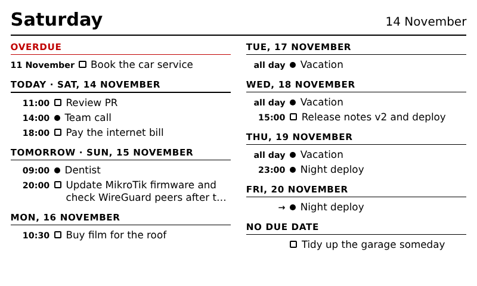
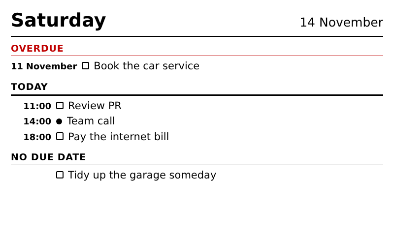
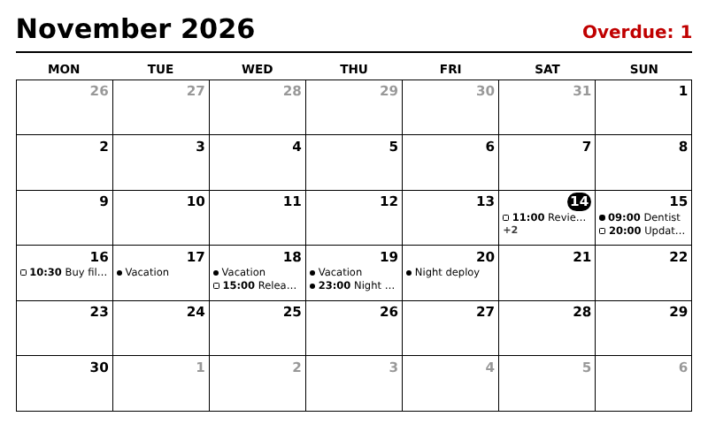

# InkyPi-CalDAV

An [InkyPi](https://github.com/fatihak/InkyPi) plugin that shows events and tasks from any CalDAV server with optional authorization.



*Agenda view on an 800×480 display: overdue tasks, events and tasks for the coming days, tasks without a due date.*



*"Today only" view: a single column with larger type.*



*Month grid with the overdue task counter in the header.*

## Features

- **Three views**: agenda for the next N days, today only (single column, larger type) and a month grid.
- **Events and tasks**: `VEVENT` and `VTODO`. Tasks are placed on their due date, overdue tasks get their own block, completed tasks are hidden.
- **Authorization**: Basic (username + token or password), Bearer token, or none. The secret can live in InkyPi's `.env` instead of the plugin settings.
- **Calendar discovery**: point it at a principal URL and it finds all calendars, or give it a single calendar URL. Optional filter by calendar name.
- **Translations**: English by default, Russian and Greek included, more can be added as JSON files.
- **No extra dependencies**: uses `requests`, `icalendar` and `recurring_ical_events`, which InkyPi already installs.

## Installation

Install the plugin with the InkyPi CLI (included in recent InkyPi versions):

```bash
inkypi plugin install caldav https://github.com/pushax/inkypi-caldav
```

It copies the `caldav` folder from this repository into `/usr/local/inkypi/src/plugins/caldav` and restarts `inkypi.service`. To update, run the same command again: it replaces the installed copy with the latest version. To remove the plugin:

```bash
inkypi plugin uninstall caldav
```

`inkypi plugin list` shows the installed plugins.

After the restart the plugin appears in the web UI as **CalDAV**.

## Setup

1. **CalDAV URL**: the principal, calendar home or single calendar URL of your server. Given a principal or home URL, the plugin discovers all calendars under it.
2. **Authorization**: Basic (username plus password, app password or token), Bearer token, or none.
3. Pick a view and save.

Typical URLs:

| Server | URL |
|---|---|
| Nextcloud | `https://<host>/remote.php/dav/calendars/<username>/` |
| Radicale | `https://<host>/<username>/` |
| Baikal | `https://<host>/dav.php/calendars/<username>/` |
| Vikunja | `https://<host>/dav/principals/<username>/` |
| iCloud | `https://caldav.icloud.com/` |

A plain `.ics` URL also works, with or without authorization.

### iCloud

1. Turn on two-factor authentication for your Apple ID, then create an app-specific password at [account.apple.com](https://account.apple.com) → **Sign-In and Security** → **App-Specific Passwords**.
2. In the plugin settings use URL `https://caldav.icloud.com/`, authorization **Basic**, your Apple ID email as the username and the app-specific password as the token.

The plugin finds your calendars on whichever iCloud server holds them. iCloud Reminders are not available over CalDAV since iOS 13, so only events are shown; turn off **Show tasks** for iCloud.

### Keeping the token out of device.json

A token typed into the settings form is stored by InkyPi in plain text in `src/config/device.json`. To avoid that, leave the token field empty and add the secret to InkyPi's `.env` file:

```
CALDAV_TOKEN=your-secret
```

The key name can be changed in the **.env key** field, which lets several plugin instances use different accounts.

## Settings

| Setting | Description |
|---|---|
| CalDAV URL | Principal, calendar home or single calendar URL |
| Authorization | Basic, Bearer token or none |
| Username | Used with Basic authorization |
| Token / password | The secret; leave empty to read it from `.env` |
| .env key | Name of the `.env` variable, `CALDAV_TOKEN` by default |
| Verify TLS certificate | Turn off for a self-signed certificate |
| Calendars | Comma-separated calendar names; empty means all |
| View | Agenda, Today only, or Month grid |
| Days ahead | Agenda range, 1–60 days |
| Show events / Show tasks | Toggle `VEVENT` and `VTODO` separately |
| Show tasks without a due date | Adds a "No due date" block to the agenda and today views |
| Language | Language of the labels on the display |
| Week starts on | Monday or Sunday (month grid) |
| Title | Optional custom header |

Time zone and 12/24-hour format come from the global InkyPi settings.

## Translations

English is built in and is the default. Every other language is a file in `caldav/locales/<code>.json`, and each file shows up in the **Language** dropdown after a service restart. Included: `ru` (Russian), `el` (Greek).

To add a language, copy `locales/en.json` to e.g. `locales/de.json` and translate the values:

| Key | Content |
|---|---|
| `name` | Language name shown in the dropdown |
| `weekdays`, `weekdays_short` | 7 items, starting with Monday |
| `months` | 12 names used in the month header |
| `months_gen` | 12 forms used in dates ("13 November"); repeat `months` if your language has one form |
| `today`, `tomorrow`, `overdue`, `undated`, `empty`, `all_day` | Labels |

Missing keys fall back to English, so a partial translation works.

The default InkyPi font may not cover every script. If you see empty boxes instead of letters, pick another font in the plugin's style settings.

## Troubleshooting

Errors are shown in the web UI when you save or update the plugin:

| Message | What to check |
|---|---|
| CalDAV authorization failed | Username and secret; many servers require an app password or token instead of the account password |
| CalDAV discovery failed (HTTP 404) | The URL, including the trailing slash |
| No calendars found at this URL | Use the direct calendar URL |
| TLS certificate check failed | Set **Verify TLS certificate** to No for self-signed certificates |

More detail is in the service log: `journalctl -u inkypi -f`.

## Status

Early version, actively maintained. Issues and pull requests are welcome, translations especially.
